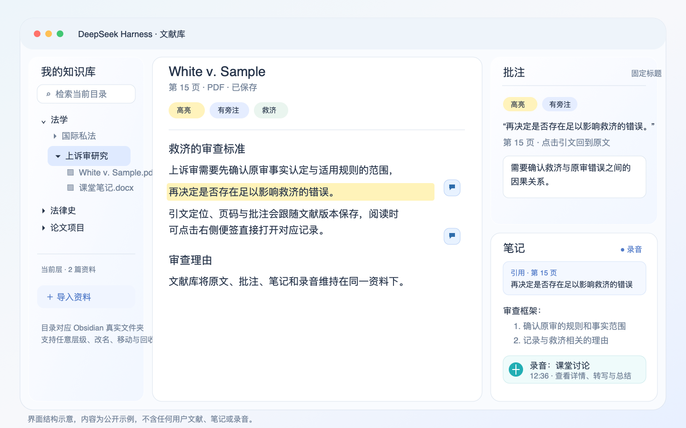

# 文献库

DeepSeek Harness 的本地文献库插件。它把 Obsidian 知识库中的 PDF、DOCX、Markdown 和 HTML 文件放进同一个阅读界面，提供本地搜索、批注、富文本笔记、伴读会话、学习记录和 Whisper 离线转写。

适用 DeepSeek Harness `>=0.2.1-rc.5 <0.3.0-0` 与 Node.js 24 或更高版本。代码使用 MIT 许可证，上游许可证见 [THIRD-PARTY-NOTICES.md](THIRD-PARTY-NOTICES.md)。

## 界面展示



上图使用示例资料绘制，展示真实界面的工作区域。左侧是 Obsidian 目录和当前层检索，中间阅读原文，右侧上方固定批注栏，右侧下方为同一篇文献的笔记和录音。Harness 工作区侧栏保持原生显示，可继续进入插件、自动化任务与会话记录。

## 安装

在 Harness 的「插件」页选择「添加插件」，输入固定发布版本：

```text
github:3469915488-oss/dsh-literature-hub#v2.1.3
```

重启 Harness，在「已安装」列表中启用「文献库」。插件关闭时保留知识库资料、笔记、批注、录音和会话投影。

默认知识库为 `~/Documents/Obsidian`。使用其他 Obsidian 知识库时，在 `~/.dsh/profiles/desktop/cordis.patch.yml` 配置：

```yaml
- id: literature-hub
  config:
    vaultPath: /绝对路径/我的-Obsidian-知识库
```

完整操作见 [使用指南](docs/使用指南.md)。

## 五分钟开始

1. 在 Harness 的「插件」页添加并启用文献库，重启应用。
2. 打开主侧栏的「文献库」，在左侧选择已有目录或创建文件夹。
3. 点击「导入资料」，导入 PDF、DOCX、Markdown 或 HTML 文件。
4. 在正文选中文字，选择高亮、下划线、勾画、旁注或向伴读提问。
5. 打开「笔记」，编辑随记，或录制音频后点击「转写」。需要 AI 总结时，在录音详情中点击「智能总结」。

完整的按钮位置、保存规则和故障处理见 [界面导览](docs/界面导览.md)、[使用指南](docs/使用指南.md) 与 [Whisper 离线转写部署](docs/Whisper部署.md)。

## 功能

- 真实文件夹树，支持多级目录、导入、改名、移动、当前层搜索和可恢复删除。
- PDF 阅读、DOCX 结构化正文解析、中文预览、扫描 PDF 按需本地 OCR。
- 高亮、下划线、勾画、旁注和自定义标签。正文标记、批注面板和笔记引用互相定位。
- 每篇文献一个同目录 Markdown 笔记，批注引用、自由笔记和录音卡共用富文本编辑器。
- 原生 Harness 伴读对话。Agent 可查询当前资料、本地知识库、笔记、批注、学习档案和引用信息。
- 手动开启学习，保存知识地图、练习、错题和复习卡。
- 本地 Whisper 多语转写、波形播放和可拖动录音详情窗。总结只在点击后将完整转写稿发送给当前 Harness 模型。

文献库没有联网检索或网页抓取。原件、解析正文、批注、笔记和音频都保存在知识库中。

## 文档

- [使用指南](docs/使用指南.md)
- [界面导览](docs/界面导览.md)
- [Whisper 离线转写部署](docs/Whisper部署.md)
- [更新记录](CHANGELOG.md)
- [第三方许可证](THIRD-PARTY-NOTICES.md)

## 开发

```bash
npm ci --legacy-peer-deps --ignore-scripts
npm run build
DSH_RUNTIME_MODULES=/Applications/DeepSeek\ Harness.app/Contents/Resources/runtime/primary-runtime/node_modules npm test
```

测试需要 DeepSeek Harness 宿主运行时，`DSH_RUNTIME_MODULES` 应指向其中包含 `@deepseek-ai/dsh-tools` 与 `@deepseek-ai/schemastery` 的 `node_modules` 目录。发布包不包含开发依赖或测试文件。

构建不依赖 CDN。`lib/` 提供后台、资料保存、解析、搜索和录音任务，`reader/` 提供阅读器与笔记编辑器，`lib/client.js` 将文献库入口接入 Harness 原生侧栏和会话界面。
