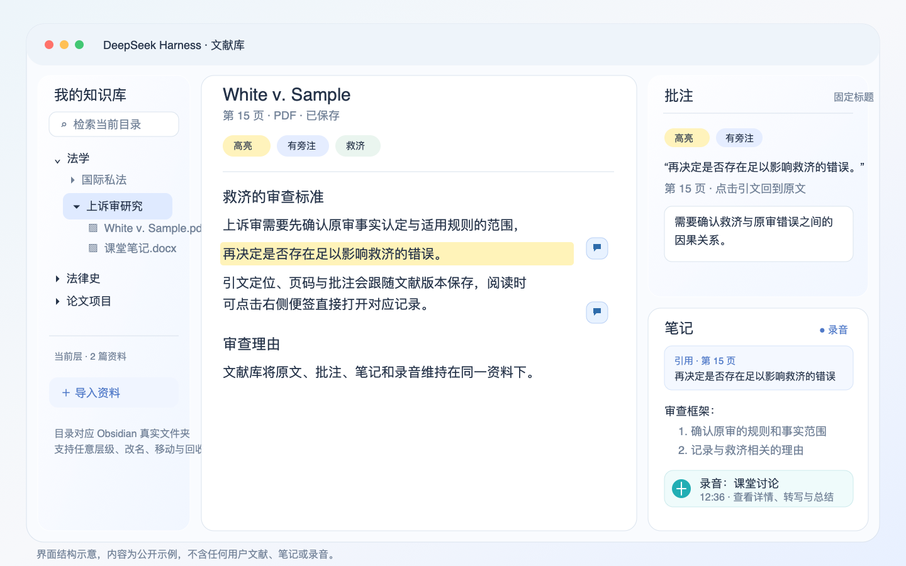

# 界面导览

图中内容为示例，用于说明控件位置和资料流转，不包含任何用户文献、笔记或录音。

## 顶部控制

文献库顶部左侧有两个开关。第一个控制 Harness 工作区侧栏，展开后可继续使用原生的插件、自动化任务和对话记录。第二个控制文献库目录。窗口宽度不足时，目录和伴读会变成抽屉，已经展开的目录不会因打开文献、进入笔记或收起 Harness 侧栏而改变。

标题会显示当前文献。右侧的伴读按钮可展开或收起当前文献的原生 Harness 对话。

## 资料目录

左栏显示 Obsidian 知识库的真实文件夹。文件夹支持任意层级的建立、改名和移动。搜索默认只在当前目录当前层执行，避免把其他研究主题混入结果。

导入资料会复制原件到当前目录。已存在于知识库的 PDF、DOCX、Markdown、HTML 文件可直接阅读。每篇文献均有「命名」和「删除」操作。改名会更新原件、关联笔记和文献库链接。删除先进入回收站，可从目录菜单恢复。

## 阅读与批注

中间区域显示原文。PDF 可缩放和翻页，DOCX 既保留结构化正文，也生成独立预览。扫描 PDF 只对缺少可用文字层的页面运行本地 OCR。

选定文字后会出现操作浮层，可创建高亮、下划线、勾画、旁注或提问。取消选区后浮层关闭。每条正文批注在右侧留白中以对话气泡标记，点击会打开对应批注。临近标记会错开或聚合，不覆盖正文。

批注栏标题固定，引文内容可点击回到原文定位。卡片顶部有「高亮」「下划线」「勾画」「有旁注」等状态标签，也可以添加自定义标签。批注栏和笔记页编辑的是同一份旁注。

## 笔记

点击文献的「笔记」页进入富文本编辑器。编辑器支持标题、分层段落、粗体、引用、链接、待办、嵌套列表、有序列表、撤销和重做。

新建批注后，编辑器自动插入一个「引用内容＋笔记正文」块。同一条批注只插入一次，引用块和录音卡可以拖动排序。删除批注会删除关联引用块，删除引用块也会删除正文对应批注。自由笔记不受影响。

首次写入时，插件在原文同目录创建 `文献名笔记YYYY-MM-DD.md`。之后所有编辑都保存到同一份 Markdown，首次日期保持不变。Obsidian 外部编辑发生冲突时，插件保留草稿和磁盘版本供处理。

## 录音与转写

笔记工具栏的录音按钮可开始、暂停、继续和停止录音。录音卡显示名称、录制时间、时长和「查看详情」。详情面板可拖动，包含波形、播放暂停、前后跳 5 秒、智能总结、待办事项和转写原文。

转写在本机完成。首次使用可在详情面板下载并校验 Whisper 多语 `small` 模型。点击「智能总结」时，只有这条录音的完整转写文字会发送给当前 Harness 模型，音频仍保留在知识库中。部署条件和排错见 [Whisper 离线转写部署](Whisper部署.md)。

## 伴读与学习

伴读会话与当前文献绑定。选文提问会带上选文、可靠页码或段落锚点。回答可引用阅读器位置并跳回原文。

学习页默认关闭。手动开始后可维护知识地图、学习任务、答题反馈、错题和复习卡。阅读、搜索、笔记和离线转写不依赖网络，只有主动使用伴读或智能总结时会使用 Harness 当前配置的模型。
